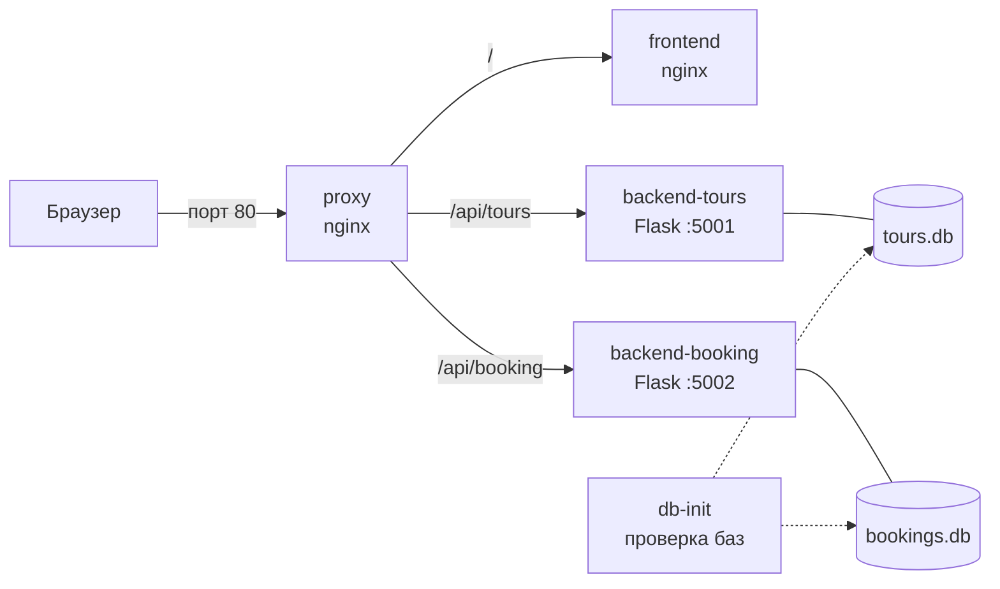

# СИЛА ПУТЕШЕСТВИЙ — сайт туристического агентства

Веб-приложение для просмотра каталога туров и онлайн-бронирования, построенное на микросервисной архитектуре и упакованное в Docker-контейнеры. Проект включает кластерное развёртывание в Docker Swarm и автоматизацию сборки, тестирования и публикации образов через GitHub Actions.

Проект выполнен в рамках курсовой работы по дисциплине «Настройка и администрирование сервисного программного обеспечения» (РТУ МИРЭА).

## Возможности

- Главная страница с поиском и подборкой популярных направлений.
- Каталог всех туров с поиском по названию и описанию.
- Форма бронирования с проверкой обязательных полей.
- Хранение туров и заявок в базах данных SQLite.
- Единая точка входа через обратный прокси (nginx).

## Архитектура

Система состоит из пяти контейнеров, объединённых общей сетью. Снаружи доступен только порт 80 контейнера `proxy`.



| Контейнер | Образ | Назначение |
|---|---|---|
| `frontend` | nginx:alpine | Отдаёт страницы, стили, скрипты и изображения |
| `backend-tours` | python:3.11-slim | Микросервис каталога туров и поиска |
| `backend-booking` | python:3.11-slim | Микросервис приёма заявок на бронирование |
| `db-init` | alpine | Разовая проверка наличия баз данных и таблиц |
| `proxy` | nginx:alpine | Единая точка входа, маршрутизация запросов |

## Технологии

HTML, CSS, JavaScript · Python 3.11, Flask, gunicorn · SQLite · Docker, Docker Compose, Docker Swarm · nginx · GitHub Actions · Docker Hub

## Структура проекта

```
tourism-platform/
├── .github/workflows/deploy.yml   # пайплайн CI/CD
├── backend-booking/               # микросервис бронирования
├── backend-tours/                 # микросервис каталога туров
├── db-init/
│   ├── db/                        # базы данных tours.db и bookings.db
│   ├── check-db.sh                # скрипт проверки баз
│   └── Dockerfile
├── frontend/                      # страницы, css, js, images
├── proxy/                         # конфигурация прокси-сервера
├── docker-compose.yaml            # локальный запуск и тесты
├── docker-stack.yaml              # развёртывание в Docker Swarm
└── init_db.py                     # создание и наполнение баз данных
```

## Требования

- [Docker](https://docs.docker.com/get-docker/) (Docker Desktop для Windows/macOS или Docker Engine для Linux) с поддержкой Compose v2.
- Свободный порт 80.
- Git.
- Python

## Быстрый запуск (Docker Compose)

Готовые базы лежат в `db-init/db/`. Чтобы создать их заново с начальными шестью турами, выполните из корня проекта:
```bash
python init_db.py
```
Далее 
```bash
git clone https://github.com/dvoynyk/tourism-platform.git
cd tourism-platform
docker compose up -d --build
```

После запуска откройте <http://localhost>.

Остановка:

```bash
docker compose down
```

Контейнер `db-init` после проверки баз завершается — это нормально, в списке он будет со статусом «Exited (0)».

> Если у вас установлен старый Compose v1, используйте команду `docker-compose` вместо `docker compose`.

## Запуск в кластере (Docker Swarm)

В этом режиме образы берутся из Docker Hub (их публикует пайплайн CI/CD), а сервисы запускаются в нескольких репликах.

```bash
# 1. Остановить Compose, чтобы освободить порт 80
docker compose down

# 2. Инициализировать кластер
docker swarm init

# 3. Развернуть стек
docker stack deploy -c docker-stack.yaml tourism

# 4. Проверить состояние
docker service ls
docker stack ps tourism
```

Через 20–30 секунд сайт будет доступен на <http://localhost>. Ожидаемое состояние сервисов: `frontend` и `backend-tours` — 2/2 реплики, `backend-booking` и `proxy` — 1/1, `db-init` — 0/1 (выполнился и завершился).

Полезные команды:

```bash
# Масштабирование сервиса
docker service scale tourism_backend-tours=3

# Обновление сервиса до последней версии образа
docker service update --force --image dvoynyk/tourism-frontend:latest tourism_frontend

# Остановка и выход из режима Swarm
docker stack rm tourism
docker swarm leave --force
```

## API

Все запросы идут через прокси на порт 80.

### `GET /api/tours`

Возвращает список туров. Необязательный параметр `search` ищет по названию и описанию.

```bash
curl http://localhost/api/tours
curl "http://localhost/api/tours?search=Рим"
```

### `POST /api/booking`

Создаёт заявку на бронирование. Обязательные поля: `tour_id`, `user_name`, `phone`.

```bash
curl -X POST http://localhost/api/booking \
  -H "Content-Type: application/json" \
  -d '{"tour_id": 1, "user_name": "Иван Иванов", "phone": "+79990000000", "email": "ivan@mail.ru", "travel_date": "2026-12-01", "guests_count": 2}'
```

| Код | Значение |
|---|---|
| 201 | Заявка создана, в ответе приходит `booking_id` |
| 400 | Не заполнены обязательные поля |
| 500 | Внутренняя ошибка сервера |

## Возможные проблемы

| Проблема | Решение |
|---|---|
| `port is already allocated` | Порт 80 занят. Остановите другой веб-сервер или контейнеры (`docker compose down`, `docker stack rm tourism`) |
| Сайт не открывается сразу после запуска | Подождите 20–30 секунд: прокси стартует, пока остальные сервисы поднимаются |
| `db-init` завершился с ошибкой | Проверьте, что файлы `tours.db` и `bookings.db` лежат в `db-init/db/` и содержат нужные таблицы |
| Ошибка `exec ... check-db.sh: no such file` | Скрипт сохранён с окончаниями строк Windows (CRLF). Пересохраните его с LF |
| Старые данные после изменений | Выполните `docker compose up -d --build` (с пересборкой) |
